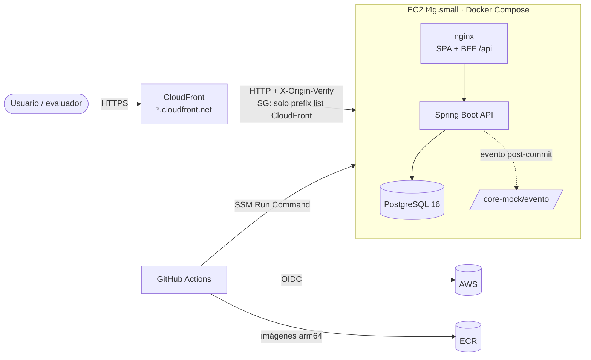

# Plataforma de Gestión de Pólizas de Arrendamiento

Prueba técnica **Desarrollador TI / Sénior**: pólizas individuales y colectivas, renovación con IPC, integración
con el CORE e infraestructura como código.

[](https://github.com/JulianMediina/prueba-polizas/actions/workflows/ci.yml)
[](https://github.com/JulianMediina/prueba-polizas/actions/workflows/deploy.yml)

## Demo en línea

**URL:** https://d3l78drj5ly5ij.cloudfront.net (disponible durante el periodo de evaluación)

- Interfaz web: la URL raíz.
- API directa (exige `x-api-key`): `https://d3l78drj5ly5ij.cloudfront.net/polizas`. La key de la demo se entrega por separado; no está en
  el repositorio.

## Entregables por módulo

| Módulo | Entregable | Ubicación |
|---|---|---|
| 1 – Diseño de sistema | Arquitectura AWS, 3 patrones, modelo de datos, escalabilidad, observabilidad, tolerancia a fallos, versionado, diagramas C4/secuencia/ER y ADRs | [docs/modulo-1-arquitectura.md](docs/modulo-1-arquitectura.md), [docs/adr/](docs/adr/) |
| 2 – Código | API Spring Boot en capas, entidades `Poliza`/`Riesgo`, 6 endpoints + mock del CORE, reglas de negocio, `x-api-key`, 64 tests | [backend/](backend/) ([README](backend/README.md)) |
| 2 – Interfaz | SPA Angular 22 + Material M3 | [frontend/](frontend/) |
| 3 – BBDD | 6 estrategias de optimización + scripts Oracle y benchmark PostgreSQL | [docs/modulo-3-sql.md](docs/modulo-3-sql.md), [sql/](sql/) |
| 4 – Git | `git cherry-pick -x` + demo reproducible | [docs/modulo-4-git.md](docs/modulo-4-git.md), [scripts/demo-cherry-pick.sh](scripts/demo-cherry-pick.sh) |
| 5 – Liderazgo | Prioridades, organización, métricas, prácticas y gestión de la presión | [docs/modulo-5-liderazgo.md](docs/modulo-5-liderazgo.md) |
| Transversal | IaC Terraform, CI/CD con OIDC, escaneo de seguridad | [infra/](infra/), [.github/workflows/](.github/workflows/) |

## Arquitectura del despliegue demo



- **Sin SSH ni llaves estáticas:** GitHub Actions asume un rol por OIDC (solo el environment `demo` de este repo) y
  despliega por SSM Run Command.
- **La API key nunca llega al navegador:** el nginx del frontend actúa como BFF en `/api` y la agrega del lado del
  servidor. La API directa (`/polizas`, `/riesgos`, `/core-mock`) exige que el cliente envíe su propia key.
- **Secretos** generados por Terraform en SSM Parameter Store (SecureString).
- Costo estimado de 4 días: **< US$3**. Justificación y equivalencias con producción en
  [ADR 0004](docs/adr/0004-despliegue-demo-ec2.md).

## Ejecutar en local

Requisitos: Docker con Compose v2.

```bash
git clone https://github.com/JulianMediina/prueba-polizas.git && cd prueba-polizas
cp .env.example .env          # editar valores; para la evaluación: API_KEY=123456
docker compose up --build
```

- Frontend: <http://localhost:8080>
- API directa: <http://localhost:8081> (con `x-api-key: 123456`)

Sin Docker:

```bash
# Backend (requiere un PostgreSQL 16 local)
cd backend && API_KEY=123456 DB_APP_USER=postgres DB_APP_PASSWORD=postgres ./mvnw spring-boot:run
# Frontend (proxy /api -> localhost:8080 agregando la key desde el entorno)
cd frontend && npm ci && API_KEY=123456 npx ng serve     # http://localhost:4200
```

Tests:

```bash
cd backend && ./mvnw verify                            # 64 tests, PostgreSQL embebido (sin Docker), JaCoCo ≥ 80 %
cd frontend && npx ng lint && npx ng test --watch=false
```

## Infraestructura como código

```
infra/
├── bootstrap/          # una vez, local: bucket de estado (S3 + lockfile), OIDC de GitHub, rol de despliegue
├── modules/
│   ├── network/        # VPC, subred pública, SG con prefix list de CloudFront (sin puerto 22, sin NAT)
│   ├── registry/       # ECR (scan on push, tags inmutables, lifecycle)
│   ├── app-host/       # EC2 Graviton, IMDSv2, EBS cifrado, rol SSM, secretos en Parameter Store
│   └── edge/           # CloudFront: HTTPS, caché de assets, verificación de origen
└── envs/demo/          # composición del entorno (backend S3 parcial)
```

| Workflow | Disparador | Qué hace |
|---|---|---|
| [`ci.yml`](.github/workflows/ci.yml) | PR y push | Backend (tests + JaCoCo), **e2e con docker compose** (SPA, BFF, 401/409/422, registro CORE-MOCK), frontend (lint, tests, build, key fuera del bundle, `npm audit`), IaC (fmt, validate, tflint, Trivy), Gitleaks |
| [`deploy.yml`](.github/workflows/deploy.yml) | push a `main` | `terraform apply` → imágenes arm64 a ECR (+ Trivy) → despliegue vía SSM → smoke test |
| [`destroy.yml`](.github/workflows/destroy.yml) | manual (escribir `DESTRUIR`) | `terraform destroy` del entorno demo |

Puesta en marcha desde cero en otra cuenta:

```bash
cd infra/bootstrap
printf 'terraform {\n  backend "local" {}\n}\n' > backend_override.tf   # primer apply con estado local
terraform init && terraform apply -var github_repo=OWNER/REPO -var github_oidc_repo=OWNER@ID/REPO@ID
rm backend_override.tf && terraform init -migrate-state -backend-config="bucket=$(terraform output -raw tfstate_bucket)"
# En GitHub: environment "demo" con las variables AWS_ROLE_ARN, AWS_REGION y TF_STATE_BUCKET (outputs del bootstrap)
```

## Supuestos de negocio

1. Canon de la póliza = suma de los cánones de los riesgos activos; prima = canon × meses de vigencia.
2. La renovación actualiza la misma póliza: la nueva vigencia empieza donde termina la actual, cada riesgo activo
   sube con el **IPC del año anterior** al inicio de la nueva vigencia (tabla `ipc`, fuente DANE) y el estado pasa a
   `RENOVADA`. Si falta el IPC, se responde 422 y no se usa un valor supuesto.
3. El riesgo único de una individual no se cancela por separado (se cancela la póliza); una colectiva conserva al
   menos un riesgo activo.
4. La sincronización con el CORE es posterior al commit y no revierte la operación si falla (ver ADR 0002).

## Posibles mejoras

- Transactional Outbox + EventBridge/SQS para entrega garantizada al CORE y notificaciones.
- Autenticación de usuarios (Cognito/OIDC) y autorización por inmobiliaria en el BFF.
- OpenAPI (springdoc) publicado y *contract testing*.
- Job de renovación automática por lotes y reconciliación con el CORE.
- Alta disponibilidad (EKS/ECS Multi-AZ + Aurora) según el diseño del Módulo 1.
