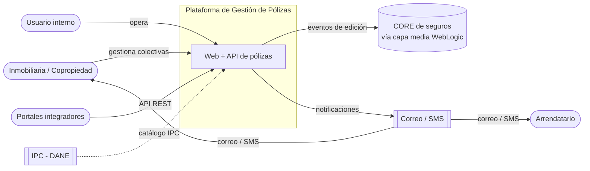
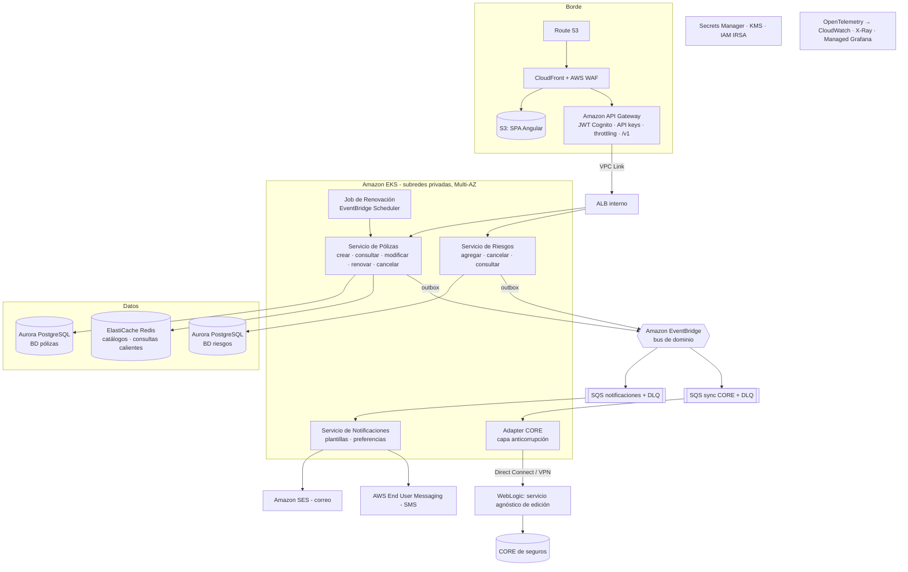
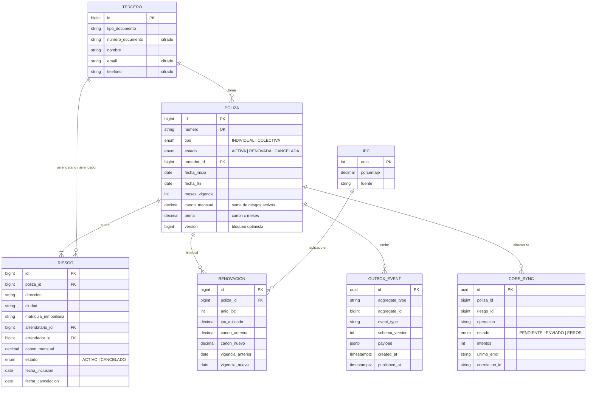
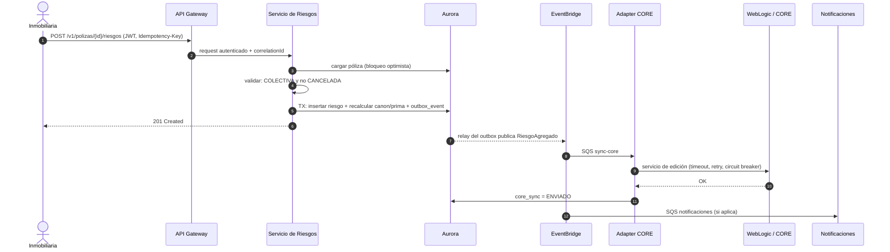
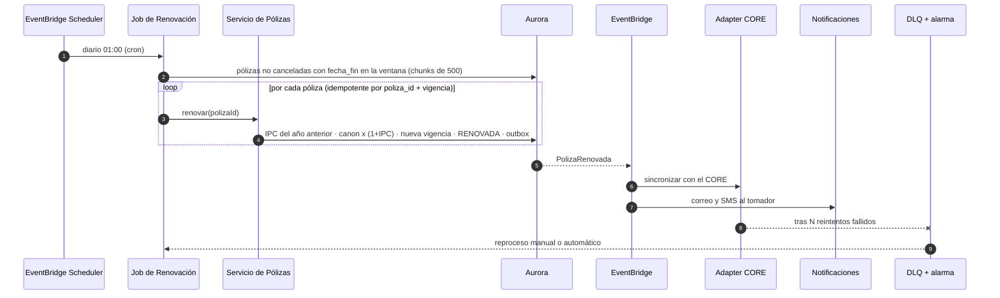

# Módulo 1 – Diseño de sistema: Plataforma de Gestión de Pólizas

> Arquitectura objetivo de producción en AWS. La implementación del Módulo 2 y el despliegue demo
> son una versión reducida y consciente de este diseño (ver [ADR 0004](adr/0004-despliegue-demo-ec2.md)).

## 1. Contexto y supuestos

**Actores**

| Actor | Rol en la póliza |
|---|---|
| Inmobiliaria / administración de copropiedad | Tomador de la póliza **colectiva** |
| Arrendatario | Asegurado (en la individual también es el tomador) |
| Arrendador | Beneficiario en caso de siniestro |
| Usuario interno de la aseguradora | Opera la plataforma (back-office) |
| Integradores (portales de inmobiliarias) | Consumen la API con credenciales de máquina |
| CORE de seguros (legado) | Sistema de registro; se actualiza a través de un servicio agnóstico de edición en WebLogic |

**Supuestos explícitos**

1. El **canon de la póliza es la suma de los cánones de sus riesgos activos**. En la individual coincide con el
   canon de su único riesgo; en la colectiva cada inmueble tiene su canon. **Prima = canon × meses de vigencia.**
2. La **renovación** se hace por el mismo periodo inicial, empieza donde termina la vigencia actual y ajusta el
   canon de cada riesgo con el **IPC del año anterior** al inicio de la nueva vigencia (fuente DANE).
   Se actualiza la misma póliza (estado `RENOVADA`) y se guarda el historial en `renovacion`.
3. El riesgo único de una póliza individual no se cancela por separado: se cancela la póliza. Una colectiva
   conserva al menos un riesgo activo.
4. El CORE es la fuente de verdad contable; la plataforma es la fuente de verdad operativa y le informa cada
   cambio de estado. El CORE puede estar lento o caído sin que la plataforma deje de operar.

## 2. Arquitectura de alto nivel (AWS)

### 2.1 C4 – Nivel 1: contexto

### 2.2 C4 – Nivel 2: contenedores

### 2.3 Componentes

| Componente | Responsabilidad | Tecnología |
|---|---|---|
| **API Gateway** | Punto único de entrada: autenticación (JWT de Cognito para personas, API keys + planes de uso para integradores), *throttling*, versionado por ruta, validación básica | Amazon API Gateway (REST) + WAF |
| **Servicio de Pólizas** | Ciclo de vida de la póliza; reglas de vigencia, prima y renovación; dueño del agregado `Poliza` | Spring Boot en EKS |
| **Servicio de Riesgos** | Riesgos de las colectivas (agregar, cancelar) y el riesgo único de la individual; consultas por inmueble/arrendatario | Spring Boot en EKS |
| **Job de Renovación** | Selecciona pólizas por vencer (ventana configurable) y las renueva por lotes idempotentes | Spring Batch disparado por EventBridge Scheduler |
| **Servicio de Notificaciones** | Consume eventos `PolizaCreada` / `PolizaRenovada`, resuelve plantilla y canal, envía correo y SMS | SES + End User Messaging, plantillas versionadas |
| **Adapter CORE** | Traduce eventos de dominio al contrato del servicio de edición de WebLogic; aísla protocolo (SOAP/REST), reintentos y errores | Spring Boot + Resilience4j |
| **Base de datos** | Una base lógica por servicio; Multi-AZ; réplicas de lectura | Aurora PostgreSQL |
| **Bus de eventos** | Desacopla productores de consumidores; reglas por tipo de evento; archivo y *replay* | EventBridge → SQS (+ DLQ) |

> Nota sobre el dominio: pólizas y riesgos comparten invariantes (una individual tiene 1 riesgo; el canon de la
> póliza depende de sus riesgos). En la práctica se recomienda **empezar con un único servicio "Pólizas" que
> contenga ambos módulos** y separar Riesgos solo cuando su carga lo justifique. Si se separan, la invariante se
> protege con validación síncrona (Riesgos consulta a Pólizas) y el recálculo de canon/prima por evento.

## 3. Tres patrones de arquitectura

| # | Patrón | Por qué en este caso | Costo / trade-off |
|---|---|---|---|
| 1 | **API Gateway + microservicios** | Cargas y ritmos distintos: consultas intensivas del back-office, renovación por lotes nocturna y notificaciones en ráfagas. Desplegar y escalar por separado evita que una renovación masiva degrade la consulta. El gateway centraliza autenticación, *rate limiting* por integrador y versionado. | Más piezas que operar; mitigado con plantillas de servicio, observabilidad común y un único repositorio de IaC. |
| 2 | **Event-Driven con Transactional Outbox** | Notificar y sincronizar con el CORE **no debe bloquear ni tumbar** la transacción de negocio. El evento se escribe en la tabla `outbox_event` en la misma transacción que el cambio; un *relay* lo publica en EventBridge. Garantiza "al menos una vez" sin transacciones distribuidas. | Consistencia eventual con el CORE; consumidores idempotentes (clave `eventId`). |
| 3 | **Hexagonal + capa anticorrupción (ACL) hacia el CORE** | El CORE es legado y su contrato (SOAP/XML en WebLogic) no debe contaminar el dominio. El puerto `CorePolizasPort` define *qué* se informa; el adapter decide *cómo*. Permite probar sin el CORE (mock), cambiar de protocolo y concentrar resiliencia y traducción de errores en un solo lugar. | Una capa de mapeo adicional que mantener. |

*Complementarios:* CQRS ligero para consultas (réplicas de lectura + caché), Saga orquestada para la renovación
(renovar → CORE → notificar, con compensación si el CORE rechaza), Circuit Breaker / Retry / Bulkhead.

**Cómo se ve en el código del Módulo 2:** el dominio rico (`Poliza` como agregado raíz), el puerto
`CorePolizasPort` con `CoreHttpAdapter` (timeout + retry + circuit breaker) y el envío al CORE **después del
commit** y de forma asíncrona (`@TransactionalEventListener(AFTER_COMMIT)` + `@Async`). El outbox queda
documentado como siguiente paso.

## 4. Modelo de datos principal

**Invariantes:** una INDIVIDUAL tiene exactamente un riesgo; una CANCELADA no se renueva ni recibe riesgos;
cancelar la póliza cancela sus riesgos en la misma transacción; canon y prima siempre se derivan de los riesgos
activos. Los datos personales (Ley 1581 de 2012) se cifran en columna o se tokenizan y nunca se escriben en logs.

> En el código del Módulo 2 el tercero se simplifica a columnas embebidas (`tomador_*`, `arrendatario_*`,
> `arrendador_*`) para mantener el alcance; el modelo de arriba es el objetivo.

## 5. Flujos principales

### 5.1 Agregar un riesgo a una póliza colectiva

### 5.2 Renovación automática

Si falta el IPC del año requerido, la póliza no se renueva y se emite una alerta operativa (no se usa un valor
supuesto).

## 6. Atributos de calidad

### Escalabilidad
- Servicios sin estado en EKS con **HPA** (CPU/RPS) y **KEDA** según la profundidad de las colas SQS.
- Aurora con **réplicas de lectura** para consultas y reportes; Redis para catálogos (IPC) y consultas calientes.
- Renovación por **lotes particionados** por fecha de vencimiento, *chunks* idempotentes y concurrencia limitada
  para no saturar el CORE (bulkhead).
- **Paginación obligatoria** en listados e índices alineados a los filtros (`tipo, estado`, `fecha_fin`).

### Logs y observabilidad
- Logs **JSON estructurados** (en el código: `logging.structured.format.console=ecs`) con `correlationId` y
  `traceId` propagados (W3C Trace Context) desde el gateway hasta el CORE.
- **OpenTelemetry** → CloudWatch Logs/Metrics + X-Ray (o Managed Prometheus + Grafana).
- Métricas **RED/USE** y de negocio: pólizas creadas/renovadas, fallos con el CORE, edad de mensajes en DLQ,
  latencia de notificaciones.
- **SLO** con alarmas: 99,9 % de disponibilidad, p95 < 300 ms en consultas, 0 mensajes en DLQ > 15 min.
- Sin datos personales en logs (enmascarado de documentos, correos y teléfonos).

### Tolerancia a fallos
- **Multi-AZ** en EKS, Aurora y Redis; *PodDisruptionBudgets*, *readiness/liveness probes*.
- **Resilience4j** en el adapter: timeout, retry con backoff exponencial y *jitter*, circuit breaker, bulkhead.
- **Outbox + DLQ + reproceso**; consumidores **idempotentes**; `Idempotency-Key` en los POST.
- **Degradación controlada:** si el CORE no responde, la operación se confirma y queda `PENDIENTE` en
  `core_sync`; la reconciliación diaria compara estados con el CORE.
- Despliegues **blue/green o canary** con rollback automático por métricas.

### Versionamiento de APIs
- Versión mayor en la URI (`/v1/...`) publicada en el gateway; cambios **compatibles** (campos nuevos opcionales)
  no suben versión.
- Cambios incompatibles → `/v2`, conviviendo con `/v1`, que se marca con los headers `Deprecation` y `Sunset` y
  una ventana de migración comunicada a integradores.
- Contratos **OpenAPI versionados** en el repositorio, *contract testing* (consumidor-proveedor) en CI.
- Eventos con `schemaVersion` y evolución **solo aditiva**; un cambio incompatible crea un tipo de evento nuevo.

## 7. Seguridad (transversal)
- Cognito (OIDC) para usuarios, API keys + planes de uso para integradores; autorización por rol/inmobiliaria.
- WAF (OWASP Top 10, *rate-based rules*), TLS 1.2+ extremo a extremo.
- Secrets Manager con rotación, KMS para cifrado en reposo, **IRSA** para que cada pod tenga solo sus permisos.
- Subredes privadas; conectividad privada con el datacenter de WebLogic (Direct Connect o Site-to-Site VPN).
- Escaneo de secretos, dependencias e imágenes en el pipeline (como en este repositorio: Gitleaks, Dependabot,
  Trivy, ECR scan on push).

## 8. Decisiones registradas
- [ADR 0001 – Microservicios con API Gateway](adr/0001-microservicios-con-api-gateway.md)
- [ADR 0002 – Event-driven con Transactional Outbox](adr/0002-event-driven-con-outbox.md)
- [ADR 0003 – Hexagonal y capa anticorrupción para el CORE](adr/0003-acl-hexagonal-para-core.md)
- [ADR 0004 – Despliegue demo en una EC2 con CloudFront](adr/0004-despliegue-demo-ec2.md)
